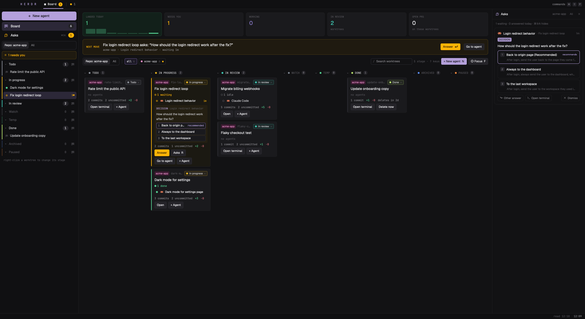

# Board (Herdr): your worktrees as a board



A layout for the [Herdr](https://herdr.dev) desktop app. Each git worktree you work in is a card on a Linear-style board,
in a stage you choose: Perpétuo (the agents you always keep open), Todo, In progress, In review, Watch, Temp, Done,
Archived, Paused. Stages are labels you pick; only two act: Done removes the worktree after 3 days, and Archived puts
its tabs away. A card shows:

- every agent working in that worktree, and the sub-agents they started, counted by status;
- its branch, commits, uncommitted lines, pull request and checks;
- the question an agent is waiting on, with every option in full to click (its column widens to fit them);
- the machine it is on, when that isn't this one: a tag with the machine's name, such as `devbox`, and
  `devbox · offline` while Herdr can't reach it.

The sidebar lists the worktrees by stage, each with its agents, in the order you drag them to. A click on a worktree
goes to its main agent, not a sub-agent that agent started.

- **Drag**: a card to another column changes its stage; within a column, it changes its place. Drag the board's
  background to scroll it sideways, as in Linear.
- **An agent beside the board**: a click on a card shows its agent's terminal at the right, and the board stays
  whole and clickable, so another click shows another agent. The bar over an agent, beside the board or in its place,
  has **Minimize**, which gives the board back the screen and the keyboard.
- **Machines**: with Herdr's ssh machines, the board and the sidebar filter by machine, and New agent asks where the
  agent runs.
- **New agent** (⌘N) makes a worktree of the shown repo and starts Claude Code or OpenCode in it. The agent's first
  message is yours plus a Context block: a Linear issue (picked from your own when `LINEAR_API_KEY` is set), a pull
  request, a Slack message, any link or note. The card gets the issue's title, the branch gets Linear's branch name.
- **Orchestrate** (optional): if you have a Claude Code skill that plans and runs work on a Linear issue, name its
  folder in `~/.config/herdr-app/board.json` as `{ "orchestrate": "<folder in ~/.claude/skills>" }`. New agent with a
  Linear issue then offers Orchestrate, on unless you untick it. It starts Claude Code in the new worktree on
  `/<skill> <your message>`, followed by the Context block with the issue. What happens next is up to your skill;
  any agents it starts in that space with `hc` (herdr-core, the command line that comes with Herdr) show on the card.
  Without the file, or where the skill isn't installed, the option isn't shown.
- **Asks** (⌘⇧A): every question your agents ask, answered from the card or the panel without opening the terminal.
  This covers permission prompts, menus of options and turns that end with a plain-text question. It is built on
  [herdr-agent-ask](https://github.com/sachin-philip/herdr-agent-ask).
- **PRs** (⌘⇧G): the open pull requests that wait on you, as a kanban with two lanes. The labels are in Portuguese
  (English in brackets here):
  - `PRs de outros` [other people's]: Draft · Precisa da minha revisão [needs my review] · Precisa do meu time [needs
    my team] · Revisado, esperando o autor [reviewed, waiting on the author] · Pronto para merge [ready to merge].
  - `Meus PRs` [mine]: Draft: revisar para liberar [draft to review and publish] · Draft: ideias [draft ideas] ·
    Comentários a resolver [comments to resolve] · Esperando review [waiting for review] · Pronto para merge.
  - Each card has the author, checks, unresolved threads, age, ↗ to GitHub, and ⌁ to the agent whose worktree is on
    the PR's branch.
  - The gear sets your GitHub org and your team's repos (a whole repo, or only a CODEOWNERS team's folders). They are
    saved in `~/.config/herdr-app/prs.json`, which the package doesn't ship.
  - Read only: nothing is ever written to GitHub.
- **Worktrees don't pile up on disk.**
  - Done removes a worktree after 3 days, unless it has uncommitted changes.
  - ⌘W on a worktree's last tab removes it.
  - `leftover worktrees · clean up` lists the ones a closed space left behind.
  - A removal keeps the branch and its commits.
- **Keyboard first**, like Linear:
  - ↑↓←→ / hjkl to move, 1–9 to jump to a stage;
  - S to change the stage, ⇧←→ to move it one stage;
  - ⏎ to open the agent, Space to peek at it, F for Focus;
  - Y to answer with the recommended option, R for the Asks panel;
  - N for a new agent, M to merge or ship the PR, / to search, ? for every key.

## Install

Ask an agent in a Herdr terminal:

```
Read ~/.config/herdr-app/AGENTS.md, then add this layout: https://github.com/ArthurRAmaral/herdr-worktree-board
```

By hand: copy `layouts/board-herdr.json` to `~/.config/herdr-app/layouts/` and `mods/board-herdr/` to
`~/.config/herdr-app/mods/`. Then merge `keys.json` into yours, which makes your keys file your own, and run
`herdr-app do layout.switch --name board-herdr`. `ctrl-shift-l` switches back; deleting the two copied items removes it.

## Keys

| Key | Where | What |
|---|---|---|
| ⌘⇧B | anywhere | the board (from another layout, switches to this one) |
| ⌘E | this layout | board ↔ the agent you were on |
| ⌘N | this layout | New agent |
| ⌘W | this layout | close the tab; on a worktree's last tab, remove the worktree |
| ⌘⇧A | this layout | the Asks panel |
| ⌘⇧G | this layout | the PRs view (again: back to the board) |

## What it runs

Mods are trusted code. This one:

- runs `git` and `gh` on the machine a worktree is on: through `hc` for one of Herdr's ssh machines, as that
  machine's login (a machine Herdr can't reach is skipped until it's back);
- runs `git` in each worktree's folder: `status`, `rev-list` and `diff --shortstat`, plus
  `worktree add|list|remove|prune` from New agent, Done and the cleanup;
- runs `gh` for each branch's pull request and checks, your PRs merged this week, and Merge PR / Ship PR
  (`gh pr merge`, `git push -u origin HEAD && gh pr create --fill`), only when you click or press M and confirm;
- runs `gh api graphql` for the PRs view, every 3 minutes while the layout is shown. It searches the open PRs of the
  org in `prs.json` (yours, asking your review, reviewed by you, and your team repos'), and reads those repos'
  CODEOWNERS file. Nothing is sent anywhere but GitHub, as your `gh` login;
- runs `hc` to read agents' screens and type your answers into them;
- runs `claude -p` (Haiku) on each finished agent turn with a `?` in it, and on a dialog it can't read. **That sends the
  agent's last message to Anthropic through your own Claude Code login**, a few seconds and under a cent per call. Set
  `"trailing_questions": false` (dialogs only) or `"classify": "off"` (never) in `~/.config/herdr-app/asks.json` to
  limit or stop it;
- reads `LINEAR_API_KEY` from your login shell, if it is set, and sends it only to `api.linear.app`;
- appends each answer to `~/.config/herdr-app/decisions.md`. The `log` setting in `asks.json` changes that file; a file
  inside the repo would leave every worktree dirty, and Done would never remove it.

Needs the Herdr desktop app (0.1.15) and git. gh, Claude Code, OpenCode and a Linear key are each optional; without
them, the part that needs them is empty.

`RECIPE.md` describes the whole build, for an agent to make it again from an empty folder.

## License

MIT, see `LICENSE`. `mods/board-herdr/asks*.js` and the `ask*.svg` icons come from herdr-agent-ask by sachin-philip
(MIT), whose notice is in `LICENSE` too.
