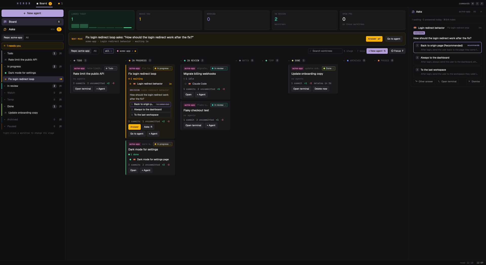

# Board (Herdr): your worktrees as a board



A layout for the [Herdr](https://herdr.dev) desktop app. Each git worktree you work in is a card on a Linear-style board,
in a stage you choose: Todo, In progress, In review, Watch, Temp, Done, Archived, Paused. A card shows:

- every agent working in that worktree, and the sub-agents they started, counted by status;
- its branch, commits, uncommitted lines, pull request and checks;
- the question an agent is waiting on, with its options to click.

The sidebar lists the worktrees by stage, most recently used first, with a link to each agent.

- **New agent** (⌘N) makes a worktree of the shown repo and starts Claude Code or OpenCode in it. The agent's first
  message is yours plus a Context block: a Linear issue (picked from your own when `LINEAR_API_KEY` is set), a pull
  request, a Slack message, any link or note. The card gets the issue's title, the branch gets Linear's branch name.
- **Asks** (⌘⇧A): every question your agents ask, answered from the card or the panel without opening the terminal.
  This covers permission prompts, menus of options and turns that end with a plain-text question. It is built on
  [herdr-agent-ask](https://github.com/sachin-philip/herdr-agent-ask).
- **Worktrees don't pile up on disk.**
  - Done removes a worktree after 3 days, unless it has uncommitted changes.
  - ⌘W on a worktree's last tab removes it.
  - `leftover worktrees · clean up` lists the ones a closed space left behind.
  - A removal keeps the branch and its commits.
- **Keyboard first**, like Linear:
  - ↑↓←→ / hjkl to move, 1–8 to jump to a stage;
  - S to change the stage, ⇧←→ to move it one stage;
  - ⏎ to open the agent, Space to peek at it, F for Focus;
  - Y to answer with the recommended option, R for the Asks panel;
  - N for a new agent, M to merge or ship the PR, / to search, ? for every key.

## Install

Ask an agent in a Herdr terminal:

```
Read ~/.config/herdr-app/AGENTS.md, then add this layout: https://github.com/ArthurRAmaral/herdr-worktree-board
```

By hand: copy `layouts/board-herdr.json` to `~/.config/herdr-app/layouts/` and `mods/board-herdr/` to
`~/.config/herdr-app/mods/`. Then merge `keys.json` into yours, which makes your keys file your own, and run
`herdr-app do layout.switch --name board-herdr`. `ctrl-shift-l` switches back; deleting the two copied items removes it.

## Keys

| Key | Where | What |
|---|---|---|
| ⌘⇧B | anywhere | the board (from another layout, switches to this one) |
| ⌘E | this layout | board ↔ the agent you were on |
| ⌘N | this layout | New agent |
| ⌘W | this layout | close the tab; on a worktree's last tab, remove the worktree |
| ⌘⇧A | this layout | the Asks panel |

## What it runs

Mods are trusted code. This one:

- runs `git` in each worktree's folder: `status`, `rev-list` and `diff --shortstat`, plus
  `worktree add|list|remove|prune` from New agent, Done and the cleanup;
- runs `gh` for each branch's pull request and checks, your PRs merged this week, and Merge PR / Ship PR
  (`gh pr merge`, `git push -u origin HEAD && gh pr create --fill`), only when you click or press M and confirm;
- runs `hc` to read agents' screens and type your answers into them;
- runs `claude -p` (Haiku) on each finished agent turn with a `?` in it, and on a dialog it can't read. **That sends the
  agent's last message to Anthropic through your own Claude Code login**, a few seconds and under a cent per call. Set
  `"trailing_questions": false` (dialogs only) or `"classify": "off"` (never) in `~/.config/herdr-app/asks.json` to
  limit or stop it;
- reads `LINEAR_API_KEY` from your login shell, if it is set, and sends it only to `api.linear.app`;
- appends each answer to `~/.config/herdr-app/decisions.md`. The `log` setting in `asks.json` changes that file; a file
  inside the repo would leave every worktree dirty, and Done would never remove it.

Needs the Herdr desktop app (0.1.15) and git. gh, Claude Code, OpenCode and a Linear key are each optional; without
them, the part that needs them is empty.

`RECIPE.md` describes the whole build, for an agent to make it again from an empty folder.

## License

MIT, see `LICENSE`. `mods/board-herdr/asks*.js` and the `ask*.svg` icons come from herdr-agent-ask by sachin-philip
(MIT), whose notice is in `LICENSE` too.
