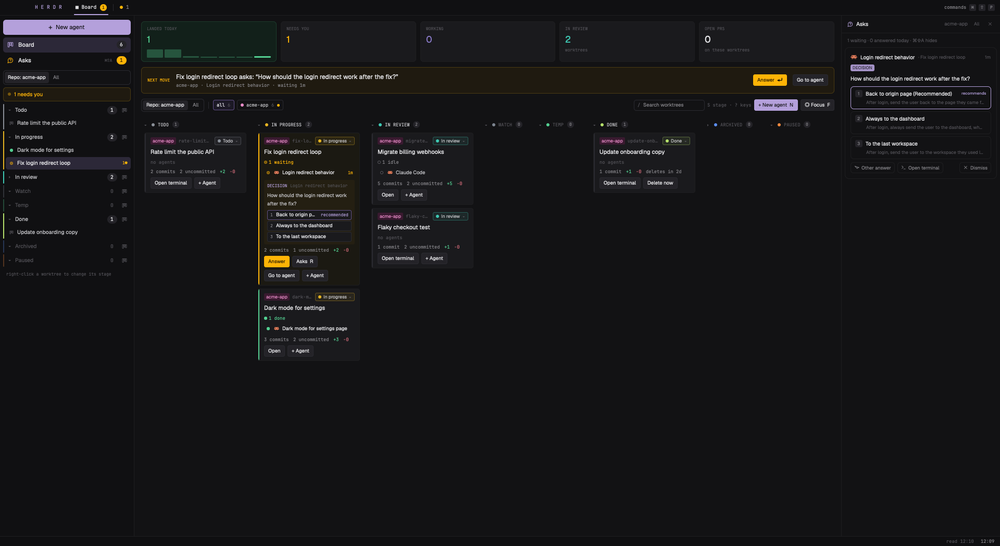

# Board (Herdr)

A Linear-style board of your git worktrees, fed by Herdr itself, git and gh. Every worktree is a card in a stage you
choose (Perpétuo, Planning, In progress, In review, Watch, Temp, Done, Archived, Paused), dragged between columns or
within one; on it, every agent working there and the sub-agents they started, counted by status, its branch, commits,
uncommitted lines and pull request, the machine it is on, and the question an agent is waiting on, with every option
to click. A click on a card shows its agent beside the board, which stays clickable; Minimize on the bar over an agent
gives the board back. A sidebar lists the worktrees by stage, in the order you drag them to, with a link to each agent.
New agent (⌘N) makes a worktree of the shown repo, on this computer or one of Herdr's ssh machines, and starts Claude
Code or OpenCode in it on your message plus a Context block (a Linear issue, a PR, a Slack message, any link), or a
skill of yours on a Linear issue. With a Linear key, the first column lists your Linear issues in Todo; dragging one
onto Planning or In progress starts it (a worktree, an agent, that column's skill) after a short confirmation, and
moves it to In Progress in Linear when it lands there. Done removes the worktree after 3 days; ⌘W on a worktree's last
tab removes it at once. A PRs view (⌘⇧G), still being built and off unless `board.json` turns it on, lays out the open
pull requests that wait on you, other people's and yours, as a kanban of where each one stands. The whole board works
from the keyboard.

## What you see

The layout is one column: a 38 px top bar, the body, a 24 px bottom bar. Colors are the graphite theme with the
layout's own `colors` (chrome `#101012`, canvas `#121214`, accent `#b4a0db`, working `#8f7fd1`, blocked `#ffb406`,
done `#53cf91`); text is Geist (UI) and JetBrains Mono (numbers, labels, terminals). The mod's own palette: top
`#101012`, side `#0f0f11`, main `#121214`, card `#1a1a1d`, raised `#242328`, hover `#1f1f23`, lines `#1e1e20` and
`#2a2a30`, text `#e4e4e7` / `#c8c8cc` / `#8a898e` / `#56555b`, accent `#b4a0db` (dim `#625187`), you `#ffb406` (on
`#1f1a10`, card `#1b1912`, question box `#241f12`, border `#4a3a12`), work `#8f7fd1`, land `#53cf91`, red `#e0707f`.

- **Top bar** (`window_drag`): `H E R D R` in 12 px mono bold accent (84 px in from the left on macOS, past the
  traffic lights at [14, 13]); a pinned `▦ Board` tab with a yellow count of agents waiting for you; a divider; the
  shown space's tabs (settled ones hidden unless blocked), each with a yellow dot (blocked) or a spinner (working); the
  shown tab underlined 2 px in accent; at the right `commands ⌘ ⇧ P` as key caps.
- **Sidebar**, 220 px (min 44, max 480), two blocks: the board's `nav` (weight 3) over Herdr's shipped `spaces`
  (weight 1).
  - `+ New agent`, 36 px, filled accent, 14 px semibold.
  - `Board` row (36 px, columns icon, count of worktrees not archived); selected when the board shows with no column
    marked.
  - `Asks` row (34 px, speech-bubble icon, `⌘⇧A` hint, a count pill: yellow when questions wait in scope).
  - The scope switch: two segments, `Repo: <name>` and `All`, 28 px. With spaces on more than one machine, a machine
    switch under it: `All machines`, `This Mac` (`This computer` elsewhere), then each machine by name, each with a
    monitor icon (`machine.svg`).
  - A needs-you row when an agent waits (yellow on `#1f1a10`, pulsing dot): `2 need you`, plus `N elsewhere` when the
    scope hides some; a click goes to the oldest question.
  - One group per stage: a 3 px bar in the stage's color, a foldable header (`▾ Planning  3`, and a columns button that
    opens the board on that column), then each worktree (30 px: status icon, its name, a machine tag when it's on
    another machine, `2●` waiting, `1◌` working, `+3` sub-agents) and, when it has more than one agent, each agent under
    it (26 px, indented 28 px, its age). Archived starts folded. Rows drag: a 2 px accent line shows where one lands
    (above or below the row under the pointer, by its half; a group's header takes it at that group's top). A hint at
    the bottom: `drag to reorder · right-click for the stage`.
  - Narrower than 160 px: a 40 px rail of icons and counts, one dot per stage.
- **Main** is a stack: `board` (the board) and `work`: a 30 px agent bar (below) over the shown tab's panes as 6
  px-radius cards, gap 6, border `#1e1e20`, focused `#625187`.
  - **The agent bar** (`#101012`, a bottom line): the agent's status icon, what it says it's doing (12 px), its
    worktree (10 px mono dim), and at the right `Minimize` (22 px, bordered, a chevron-over-a-line icon,
    `minimize.svg`) with `⌘E` in the main stack; in the side, no key. Without an agent, the tab's name.
  - **Numbers**, five tiles: `LANDED TODAY` (green, with 7 bars of your merged PRs this week, today's solid),
    `NEEDS YOU`, `WORKING` (with `+ N of M sub-agents`), `IN REVIEW`, `OPEN PRS`.
  - **Next move** banner, when someone waits: `<worktree> asks: "<question>"`, project · agent · `waiting 4m`,
    `Answer ⏎` and `Go to agent`.
  - **Chips row**: the scope switch, `N elsewhere`, a divider, project filter chips (`all 5`, then each project with
    its count and a yellow dot when one of its worktrees waits), `N leftover worktrees · clean up` when there are some,
    then a 170 px search field (`/`), a hint (`S stage · ? keys`), `+ New agent  N` and `◎ Focus  F`.
  - `devbox offline · its cards show the last read` (11 px mono, muted) under the numbers while Herdr can't reach a
    machine.
  - **The Linear column**, first, only with `LINEAR_API_KEY`: header `▾ ● LINEAR · TODO 3` in `#8b93f8`. A card per
    issue assigned to you whose state type is `unstarted`, minus the ones a worktree already has or that are being
    started: the ID in `#8b93f8` and a `↗ Linear` button (opens the issue), the title, a dim line with the project
    (else the team) and the priority unless `No priority`. Its key is `linear:<ID>`.
  - **Columns**, one per stage: header `▾ ● IN PROGRESS 2` (click folds it). A folded column is 140 px, an empty one
    118 px; columns with cards share the rest but never go below 260 px, and a column whose card asks a question widens
    to fit its options (longest option label × 6.6 + 100 px, or the question's length ÷ 3, up to 480 px). When they
    don't fit, only the columns row pans sideways (the numbers and chips keep the view's width): drag the background
    (past 4 px, with the grabbing cursor), a trackpad's sideways scroll, or the wheel with Shift; a thin bar at the
    bottom shows where you are, and moving the selection pans to its column. Each column scrolls on its own. The column
    the sidebar marked has a border and a tint in its color.
  - **A card**: a 3 px left bar in the worktree's status color; on another machine, a 2 px dashed outline (`#9a99a0`),
    like a box around it; selected (by a click or the keys), a solid 2 px outline in the accent and a tinted background
    (`#262139`, `#2d2615` for one waiting for you) that hovering keeps (the Linear column's cards too); the project chip (one of 8 colors, from its name), the
    branch, a machine tag (the machine icon and its name, such as `devbox`, or `devbox · offline` dimmed) when it's on
    another machine, the
    stage button (`● In progress ▾`, tinted in the stage color); the title (14 px semibold); when it has them, a row of
    20 px link pills under the title: `↗ ENG-12` (`#8b93f8`, opens the issue), its other pull requests (one:
    `↗ api#12`; several: `3 PRs ▾`, a scrollable list of `repo#n`, draft, checks and title, each opening on GitHub; a
    popup takes its content's height, so the list has a max height, not `flex_1`, which would leave it empty)
    and, in Planning, `📄 Plan ready` (`#53cf91`, opens the plan); marked unread, a green bar and `● unread` by the
    title. A right-click opens its menu at the pointer: `● Mark as unread  U` (or `○ Mark as read`), `⇅ Pull requests
    (3)  P` when it has several, `# Labels…  T`, `■ End agents (n)  E` when it has agents that can come back,
    `↺ Restore agents (n)  R` when it has ones ended, the stages, `× Delete worktree…  ⌫` (for a worktree under any machine's
    `~/.herdr/worktrees`); a Linear card's: `↗ Open in Linear  O` and Planning / In progress; the agents
    counted (`2 waiting · 1 working`) and, with sub-agents, `· 3 sub-agents` counted too; up to 4 agent lines (status
    icon, program icon, what it says it's doing, a `+2` sub-agent pill, its age) and `+N more`; the question box; the
    facts (`3 commits`, `2 uncommitted`, `+120 −8`, `1 unpushed`, `PR #42`, `✓ checks` / `✗ checks` / `checks running`,
    `conflicts`, `merge blocked`, `behind base`, and in Done `deletes in 2d` or `uncommitted: won't
    auto-delete`); then the actions. A card where someone waits is `#1b1912`; the selected card has an accent border.
  - **The question box** (`#241f12`): with an Asks record, its kind (`APPROVAL` yellow, `DECISION` accent, `QUESTION`
    work, `UNCLEAR` dim), the agent, the question, and every option as a row at least 24 px high that wraps (number,
    label, the option's description under it in 11 px muted when the agent gave one, `recommended` on the agent's pick,
    `recommended · Y` on the selected card); several questions at once say `3 questions: answer them in
    Asks (R)`; a failed answer shows its error and Retry. Without a record, `ASKS YOU` and the last question line on the
    agent's screen.
  - **Actions**: while someone waits, `Answer` (Focus), `Asks R` (or `Reply R`), `Go to agent`, `+ Agent`; otherwise
    `Merge PR` or `Ship PR` (green), `PR #42 ↗`, a nudge (`→ In review` when a PR is open, `→ Archived` when merged),
    `Open` (or `Open terminal`), `+ Agent`, and in Done `Delete now`. Merge and Ship ask first on the card (`Yes y` /
    `No n`); a running or failed one shows its line on the card.
  - `?` shows a key list in the board's bottom-right corner (350 px, `#18181b`).
  - **Dragging a card**: the card dims; over another card a 3 px accent line shows above or below it (by its half),
    over another column's empty part the column tints. Dropping in another column sets that stage, as the stage
    picker would; the place is kept in the same order the sidebar uses.
- **Asks panel** (hidden; 380 px, min 300, max 720) at the board's right: header with the icon, `Asks`, the scope
  (`workspace` or `All worktrees`), an `All` toggle and ×; a line `1 waiting · 3 answered today · ⌘⇧A hides`; one card
  per waiting question (agent, worktree, age, kind chip, context line, the question, each option with its description
  and `recommends`, a multi-question list that unfolds each question's choices, Claude Code's question forms (below),
  `Other answer` / `Answer` with a text
  field, `Open terminal`, `Dismiss`); a foldable `Answered N` list.
- **Focus terminal** (hidden; weight 0.5, min 360, max 1000): the agent bar over an agent's live terminal, beside the
  board; **side** (hidden, 640 px), the shown tab beside it.
- **Bottom bar**: right-aligned, the last git or gh problem in red, `devbox offline` (muted, a dim dot) while a machine
  can't be reached, `read 11:57`, the clock.
- **Dialogs**, all `#18181b`:
  - **New agent** (540×770): `AGENT` (Claude Code and OpenCode as 52 px cards with icon, command and a radio; `not
    installed` dims one); `WHERE` (with spaces on more than one machine, a machine picker at the label's right: `This
    Mac` and each machine; picking one prefers a space there of the same repo, a main checkout first, and asks that
    machine for its agents, the skill and the repo; `no space on <machine> to start from` when it has none; then `New
    worktree` with `repo · from main · ~/.herdr/worktrees/<repo>/<branch>`, or `In
    this worktree`); for a new worktree `BRANCH` (mono input, `empty: <the branch it will get>`, `on the board: <the
    title it will get>`) and `STAGE` (8 chips); `CONTEXT` (one input; your Linear issues drop down as you type; each
    reference a removable chip colored by kind: Linear `#8b93f8`, PR `#53cf91`, Slack `#e88cc8`, link `#6fb3f2`, note
    `#8a898e`); when `board.json` names skills installed on that machine (below), `SKILL · RUNS IN CLAUDE CODE` with
    `None` and one chip per skill, which turns the agent into Claude Code (the skill follows the stage when the dialog
    came from a Linear card, until you pick one); opened from a Linear card's summary, a line `New worktree of
    <repo>` when the shown space's repo isn't the remembered one; `FIRST MESSAGE (OPTIONAL)` (or `MESSAGE
    (OPTIONAL: EMPTY STARTS ON THE ISSUE)`, required with a skill and no reference); the error in red; a hint
    (`it starts working; the board stays` or `its terminal opens, to type in`), `Cancel`, `Start ⏎`.
  - **Start an issue** (420×330), opened by a Linear card dropped on Planning or In progress, ⏎ or S on it:
    `Start ENG-12?`, then rows `Machine`, `Agent`, `Repo`, `Branch`, `Skill`, `Linear` (`Todo → In Progress`, or
    `stays in Todo`), a dim line saying why it can't start (`devbox is offline`, `still checking…`, `<skill> isn't
    installed for <repo>`), and `⏎ Start` · `E Edit` · `Esc Cancel`. Machine, agent and repo are the last start's
    (`boardh.last`), else the shown space's. E opens New agent with all of it (Esc there comes back here).
  - **Stage picker** (250 px wide, 44 + 30 per stage + 40 high): `MOVE <title> TO`, one 30 px row per stage (dot, name,
    `✓` on the current one, its number), and for a worktree a red `× Delete worktree…  ⌫`. A popup at the pointer for a
    click, a centered dialog for a key.
  - **Leftover worktrees** (640×480): each worktree under `~/.herdr/worktrees` that no space shows: branch, path, what's
    at risk (`2 uncommitted changes: lost on remove` / `no uncommitted changes` / `folder already gone`, `3 commits on
    no remote (kept on the branch)`), `Open`, `Remove` (`Remove…` then a red `Remove anyway` when it has changes); a footer
    `Remove the N without changes` and `Done`.
- **PRs** (only with `features.prs` on, see Features below; the `main` stack's third child, ⌘⇧G or the sidebar's `PRs`
  row under Asks, with the pull request icon, `⌘⇧G` and an amber count pill like Asks'): a header (`PRs` 15 px semibold, `read HH:MM` or `reading…` in mono `#56555b`,
  any gh problem in red, then `hjkl move · ⏎ open · a agent · d draft`, `↻ Refresh  R` and `⚙ Repos  ,`), then two
  lanes sharing the height, each a title (`PRs de outros · N`, `Meus PRs · N`) over five columns:
  - PRs de outros: `Draft` `#56555b` · `Precisa da minha revisão` `#ffb406` · `Precisa do meu time` `#8f7fd1` ·
    `Revisado, esperando o autor` `#6fb3f2` · `Pronto para merge` `#53cf91`.
  - Meus PRs: `Draft: revisar para liberar` `#b4a0db` · `Draft: ideias` `#56555b` · `Comentários a resolver` `#e0707f` ·
    `Esperando review` `#6fb3f2` · `Pronto para merge` `#53cf91`.
  - Columns are `#141416` boxes (8 px radius, `#1e1e20` border) with the dot, the label in mono capitals and a count;
    a column with PRs is as wide as the row allows (220 px at least, then the lane scrolls sideways), one without is
    150 px. Each column's list scrolls.
  - A card (`#1a1a1d`, `#2a2a30` border, 6 px radius; selected: `#1c1926` with a `#625187` border): the title (12.5 px,
    two lines at most), then in mono 10.5 px: on others' PRs the author's initials on a 15 px colored circle and their
    login, on yours `→ ` and the reviewers asked; `repo#number`; checks `✓` `#53cf91`, `✗` `#e0707f` or `●` `#8f7fd1`;
    `💬 n` unresolved threads; the age since the last update; on others' `Pronto para merge` an amber chip with what
    blocks the merge (`conflito`, `CI falhando`, `CI rodando`); `⌁` when a worktree here is on the PR's branch; `↗`.
  - No org set: `Set your GitHub org and team repos` and `⚙ Set up`. A read that found nothing: `No open pull requests
    for you in <org>` and a hint to check the name and `gh auth status`.
  - **The gear** (620×520 dialog): `PRs: org and team repos`, a line on what they do, `Org` input, one row per team repo
    (name in mono, a `Whole repo` | `CODEOWNERS team` switch, the team's slug input for the latter, `×`), an `Add a
    repo: its name, ⏎` input, the error in red, `Cancel` and `Save`.

## How it behaves

- **The Linear column.** Read every 60 s and on a forced refresh: `viewer.assignedIssues(filter: {state: {type: {eq:
  "unstarted"}}})` with each issue's id, identifier, title, url, branchName, priority, team and project, plus the
  organization's `urlKey` and the team keys. A failed read keeps the last list and shows `linear: <reason>` in the
  bottom bar; every request gives up after 20 s. Without a key the column isn't drawn (the key is looked up at start,
  on a forced refresh, then after 5 min, 15 min and hourly).
  - A Linear card drops only on Planning (`todo`) or In progress; anywhere else it goes back. Nothing starts but the
    summary's ⏎ (or New agent's); key repeats are ignored, and a start for an issue started under 2 min ago is refused.
  - One issue, one card: an issue is hidden while it starts (`boardh.starting`, 2 min, removed if the start fails) and
    once a worktree has it: `boardh.spaceIssues` (space → `{id, url}`, set when the board makes the worktree) or the
    branch's last segment starting with `<TEAMKEY>-<n>` (not under `fix/`, `feat/` and such folders).
  - Started onto In progress (the stage it ends in counts, also when changed in E), the dialog queues
    `{uuid, teamId, id}` in `boardh.linearMoves`; the board takes the team's `started` state with the lowest position
    and runs `issueUpdate(id, {stateId})`. A failure shows `<ID> not moved in Linear: <reason>` in red. Nothing else is
    written to Linear; labels are never touched.
- **A worktree's pull requests** (pure rules in `worktree-prs.js`): its own branch's; the branch's of every folder its
  agents work in (git and gh run there too); and, for each clone under its `repos/` (a folder with its own `.git`),
  `gh pr list --author @me --state open` in that repo, kept when the PR's branch exists in that clone (a clone is the
  worktree's own; a linked worktree's branches are shared, so only its checked-out one counts). A folder whose branch
  has no pull request of its name (a review that checked a PR out as `rev/123`, or with no branch at all) gets the
  open ones of its repo, anyone's (`gh pr list --state open --limit 300 --json number,url,title,isDraft,headRefName,
  headRefOid`, once per repo per minute, without checks: those take seconds on a busy repo), whose head commit is
  among its commits over the default branch (git's read lists up to 200 as `commits=`); their checks are asked one by
  one (`gh pr view <url> --json statusCheckRollup`). Open ones only, each once, its own first. Merge and Ship stay with
  its own branch's. git runs in 8 folders at a time and gh 4 calls at a time: on another machine each one is a round
  trip, and one after another the first read of a big fleet took minutes.
- **Unread** (`boardh.unread`, space → when): your mark, set from the menu or `U`, cleared when any of its agents is
  shown (beside the board, in its place, or to answer).
- **Labels** (pure rules in `labels-rules.js`; `boardh.labels`, space → labels): your own words for a worktree
  (pesquisa, feature, bug…), none built in. `T` or the menu's `# Labels…` opens a field over the list of every label in
  use (the most used first): typing filters it, ⏎ turns the first one on or off, or makes the one typed when no label
  is exactly it; a click turns any on or off. One spelling each: trimmed, single spaces, lower case, at most 24
  characters. A card shows them as round pills in its links row, colored from the name as a project chip; the filter
  row lists them with their counts after the projects, and a click there or on a card's pill shows only that label's
  cards (again: all); `/` finds them too. `G` or `▤ group` (`boardh.group`) puts each column's cards under their first
  label (`# BUG` over the first of each group, in the card's own slot so scrolling to a card still lands on it), the
  ones without one last (`NO LABEL`). A space that is gone drops its labels.
- **Ending agents, bringing them back** (pure rules in `park-rules.js`; `boardh.parked`, space → `{at, agents:
  [{address, app, session, cwd, argv, title}]}`): archiving a worktree with agents that can come back (Claude Code,
  OpenCode, on its panes or started by them) opens `End the agents of …?`; `End n agents  ⏎` frees the machine. For
  each one: `hc get --json` gives its terminal's pid, folder and the agent's own argv; its shell's child is the agent
  (`pgrep -P`), and Claude Code's `~/.claude/sessions/<pid>.json` names its session; OpenCode's is the folder's one in
  `opencode session list --format json` whose title the terminal shows (`OC | <title>`), else the folder's newest.
  The session is kept, then that process alone gets `kill -TERM` on its machine: the terminal's shell runs the agent
  and stays, so the card keeps its terminals (`n agents ended`). Others (no session found, another agent) keep
  running and the dialog says why. Restore (the card's `↺ Restore n agents`, the menu's, or offered on leaving
  Archived) types `cd <folder> && <agent> <its flags> --resume <id>` (OpenCode: `-s <id>`) in that terminal with `hc
  send` (its first message is not repeated; a session it was resuming, `-c` or `-p` are dropped), or opens a new tab
  in the space with it when that terminal is gone, and forgets the ones it brought back. A space that is gone drops
  its record.
- **Plans.** git's read of each worktree also looks for the newest `tmp/*/plan/report.md` or `report.html` (the HTML
  when both); a Planning card with one shows `📄 Plan ready`. A click opens a local HTML as it is; Markdown, or a file
  on another machine (read with `readTextFile(…, {on})`), is written as a page under `~/.config/herdr-app/cache/plans/`
  and opened.
- **Worktrees, not agents.** Each Herdr space is one card. Its main agent, where a click on the worktree goes, is one
  no other agent in that space started (by the `parent` chain), the one with no parent at all first, then the oldest
  (hc addresses count up in base 36: `t9z` before `ta0`); never a sub-agent.
- **Your order** (`boardh.order`: space ids and agent addresses), shared by the sidebar and the board's columns: a new
  worktree comes in on top, a new agent at the end of its worktree, a worktree that changes stage at the top; a drag
  moves a key before or after the one it's dropped on; anything not in the order goes last, as it came. Pure rules in
  `nav-order.js`.
- **Machines**: a space's `machine` (null: this computer). git and gh for its folder run there (`exec(…, {on})`), and
  errors say which (`gh on devbox: …`). A machine whose layout is `unavailable` in `machines()`, or whose call fails as
  unreachable, is skipped for the rest of that read: its cards keep the last read and say `offline`, no red error. The
  machine filter (`boardh.machine`: null all, `""` this computer, else a name) applies to the board and the sidebar;
  leftover worktrees show only for this computer or all.
- **An agent beside the board**: a click on a card (or an agent line on it) shows that agent in `focus-term`
  (`agent.focus`, the board keeps the keyboard), and another click shows another; a double-click goes to it. Space
  does the same for the selection and follows it; F (Focus) opens it on the oldest question with the keyboard in the
  terminal, to type the answer. Esc on the board closes it. The board is never dimmed. A card without agents (only
  terminals) shows its space's terminals there instead, as the space arranges them: `space.select`, and the
  `focus-body` stack switches from `focus-agent` to `focus-tab` (`agent.focus` takes only agents); the bar over it
  names the space's shown tab.
- **Minimize**: in the side, it hides `focus-term`, clears `boardh.peek` and `boardh.focus`, and sets `boardh.refocus`
  so the board takes the keyboard; in the main stack, it selects `board` and the board takes the keyboard, the card
  still selected. Going to an agent's whole screen (a sidebar row, a top-bar tab, Open) hides `focus-term` first:
  `pane.focus {terminal}` prefers a visible layout block showing that terminal, so with the side open the agent
  would show twice and the keyboard would go to the side. A space's agents come from `agents()`; its sub-agents are
  the live `terminals()` whose chain of `parent`s (up to 8 hops) reaches one of them. Agents sort the most urgent first
  (blocked > done > working > idle), then the one you used last.
- **A worktree's name**: the name you gave the space, else the title New agent gave it (the Linear issue's title, else
  the first sentence of your message, cut at a word under 48 characters), else what its first agent's terminal title
  says it's doing, else the branch.
- **Two statuses kept apart.** An agent's status (working, waiting for you, done, idle) comes from the agent and is
  only shown: a spinner, a pulsing yellow dot, a green dot, a hollow dot. A worktree's stage is yours; the board never
  moves a card, it only suggests (the nudge button). Archived puts the worktree's tabs away (`tab.settle`; they keep
  running and come back when they need you); leaving Archived brings them back.
- **Scope**: the board, the sidebar and Asks show the worktrees of the shown space's repo (its git common dir), or all
  of them. `N elsewhere` counts the agents waiting where you can't see, and a click shows all.
- **Done**: moving a worktree to Done records when; 3 days later, if it is under `~/.herdr/worktrees`, isn't its repo's
  main checkout, and `git status` (checked again just before) is clean, the board closes its space, runs `git worktree
  remove` and toasts `Removed <name>` (the branch and its commits stay). Checked every minute while Herdr runs. Leaving
  Done cancels; coming back restarts the count.
- **Delete a worktree by hand**: `Delete worktree…` in the stage picker (or ⌫ there), ⌫ on the board, `Delete now` on a
  Done card, ⌘W on a worktree's last tab. Each opens Herdr's own Remove worktree dialog, which warns about uncommitted
  changes. ⌘W on any other tab closes it as usual; on the board it does nothing.
- **New agent**, new worktree:
  - The branch is what you typed, else the Linear issue's `branchName`, else `<id>-<title slug>`, else a slug of your
    message (6 words, 40 characters, accents dropped), else `agent-MMDD-HHMM`.
  - The folder is `~/.herdr/worktrees/<repo>/<branch with / as ->`.
  - If git already has a worktree for that branch or folder, it's reused: a space already showing it gets one more tab,
    else a space opens there. Worktrees whose folder is gone are pruned first. A folder that exists but isn't a worktree
    is an error on the dialog.
  - Otherwise it runs `git worktree add --no-track -b <branch> <path> origin/HEAD's branch` (or `add <path> <branch>`
    for an existing branch), then `space.new` in the folder with the agent as its first tab; the space stays unnamed so
    it nests under its repo in Spaces. The stage and title are applied when that space shows up.
  - **In this worktree**: `tab.new` in that space.
  - The first message is your text (or `Start working on the Linear issue X.` when empty with an issue), then
    `Context:` and one line per reference (`- Linear issue: INT-12 — Title (url)`, `- Pull request: owner/repo#4 (url)`,
    `- Slack message: url`, `- Link: url`, `- Note: …`).
  - With a message the board stays; without one the agent's terminal shows. The agent and stage you pick are
    remembered.
- **References**: pasting a `linear.app/…/issue/ABC-12` link or `ABC-12` makes a Linear chip (with its title when it's
  among yours), `github.com/…/pull/N` a PR, `slack.com/archives/` a Slack message, any other `http(s)` a link, anything
  else a note. With `LINEAR_API_KEY` in your shell, your 50 most recently updated open assigned issues drop down as you
  type, and after 3 letters none of them has, Linear's search (400 ms after you stop). Enter on an empty field moves to
  the message.
- **Asks** (from github.com/sachin-philip/herdr-agent-ask 0.3.0):
  - A blocked agent becomes a record within about a second. Claude Code's own report says it: `kind: question` gives a
    DECISION with its options and recommendation, `kind: permission` an APPROVAL whose Yes / Yes, and… / No come from
    the screen.
  - Claude Code's question dialog can hold several questions (one tab each) and ones that take several answers, but
    its report names only the first. The session transcript
    (`~/.claude/projects/<cwd with every non-alphanumeric as ->/*.jsonl`) has the whole `AskUserQuestion` call: its
    questions, headers, options with descriptions, `multiSelect`. Several questions, or one with several answers,
    make a form in the panel: a box per option where several fit, a dot where one does (the recommended one
    pre-picked), and `Other answer…` per question. `Send answers` appears once each question has one. The board's
    card points to the panel.
  - The form is filled one tab at a time, reading the screen after each key. A number picks and moves on under a
    one-answer question. Under a several-answer question, a number turns its box on or off, and → moves on. A typed
    answer: move to the `Type something` row, `hc send --force` the text (typing ticks it, the paste's Enter flips
    it back, so press Enter if it ended off), then Tab to the Next row and Enter. A half-done dialog is first taken
    back to its first tab with ←. Last comes the review step: press `Submit answers`.
  - Other agents' numbered options are read off the screen, with `claude -p` (Haiku) as a fallback whose options must
    all appear on screen. Otherwise the record is UNCLEAR.
  - A turn that ends asking in plain text (a `?` in the agent's last message) goes to Haiku once. If it is really
    waiting, it becomes a QUESTION whose answer is sent as a message; several questions in one message become one
    record.
  - Clicking an option (card or panel) or Y presses its number with `hc keys` and Enter if the dialog is still there,
    or `hc send`s the text, then watches for up to 8 s. Delivered means the dialog went away or the turn moved on;
    otherwise the answer is marked failed, with Retry, which never sends twice.
  - An answer still sending 3 min after it was sent was cut off by a reload (the delivery lives in memory, the record
    in `asks.state`): it becomes delivered (`Picked up late`) if the agent moved on, failed with Retry if the question
    is still up, and stale if the agent closed. A failed answer the agent takes later becomes delivered too.
  - Answering in the terminal turns the record into `Resolved in terminal` after 3 s.
  - Each answer is appended to `~/.config/herdr-app/decisions.md`.
- **Keys on the board**:
  - Moving: ↑↓/jk within a column, ←→/hl to the nearest column with cards keeping the row, 1–9 the first card of a stage.
  - Stages: S the stage picker, ⇧←/⇧→ the stage before/after, A archive/unarchive, ⌫ delete the worktree.
  - Agents: ⏎ go to the agent, Space peek (the agent in the focus block, following the selection, the keyboard stays),
    F Focus (the side opens on who waits, and the question's terminal gets the keyboard to type the answer).
  - Answering: Y answer with the recommended option, R the Asks panel.
  - Making and shipping: N/C New agent, ⇧N an agent in this worktree, M merge or ship the PR, O open the PR.
  - Filtering: / search (name, branch, project, agents, question; ↓ or ⏎ back to the cards), V repo/all, P next project.
  - ? key list. Esc backs out one step: the key list, the search, the peek, Focus, the marked column, the selection.
- **Keys anywhere in the layout** (keys.json): ⌘E board ↔ the agent you were on (also out of Focus); ⌘N New agent;
  ⌘W close the tab, or remove the worktree on its last tab; ⌘⇧A the Asks panel; ⌘⇧B the board. From any other layout,
  ⌘⇧B switches to this one.
- Clicking a space in the sidebar's Spaces shows its terminal (in All scope); a click on an agent or worktree row goes
  to its agent (hide `focus-term`, agent.focus, pane.focus, the `work` child). The sidebar's agent order is what ⌘] / ⌘[ follow.
  Right-click any worktree or agent row: the stage picker at the pointer.
- **Features still being built** (`board.json`'s `features`, each off unless it is `true`): `prs`, the PRs view. The
  sidebar's copy reads `board.json` at start and every 30 s into `boardh.features`. Off: no PRs row in the sidebar,
  ⌘⇧G (`board-herdr.prs`) and the gear do nothing, GitHub isn't read for it, and turning it off while the view shows
  goes back to the board. Every PRs rule below holds only with it on.
- **PRs: which come in.** Only open PRs of the org in `~/.config/herdr-app/prs.json` (`{"org": "acme", "team_repos":
  [{"repo": "web"}, {"repo": "monorepo", "codeowners": "payments"}]}`): yours (always), ones asking your review,
  ones you reviewed (only where your review was once asked, or in a team repo), and every PR of a team repo, nobody
  asking you; a `codeowners` entry takes only the PRs that change a file the repo's CODEOWNERS gives to
  `@<org>/<team>` (the last matching line wins, as on GitHub). Other people's PRs with no update in 30 days leave.
- **PRs: the column**, the first rule that holds:
  - Others': draft; approved (review decision APPROVED, or one approval where none is required), even with a conflict
    or failing checks (the author's to fix: the chip says it); your review asked and not given since, or the author
    pushed commits of their own (not merges of the base, not a bot's) after your last review; you reviewed; a team
    repo's. Any other is dropped.
  - Yours: a draft goes to `Draft: revisar para liberar` until `d` moves it to `Draft: ideias` (and back; kept per PR,
    dropped when it leaves draft or closes); changes requested, unresolved threads, failing checks or a conflict:
    `Comentários a resolver`; approved: `Pronto para merge` (checks still running stay here, `●`); else `Esperando
    review`.
  - Newest update first in each column. The sidebar count is Precisa da minha revisão + Comentários a resolver +
    Draft: revisar para liberar.
- **PRs: keys** (the view takes the keyboard when opened): ↑↓ / jk within a column, past its end into the other lane;
  ←→ / hl across columns with PRs; ⏎ or O open the PR in the browser (a double-click too, or `↗`); A the agent of the
  worktree on its branch (`⌁`); D a draft of yours between the two draft columns; R reads GitHub now; `,` the gear;
  Esc clears the selection. ⌘⇧G again goes back to the board.
- **PRs: reading.** On opening the view, every 3 min, on R and after the gear's Save; a hand edit of `prs.json` is
  noticed within 30 s and shows after the read in flight and one more (up to about 2 min). While reading, the last
  PRs stay; a gh failure keeps them and shows `gh: <why>` in red. Nothing is ever written to GitHub.
- The board reads git in each space's folder every 10 s and whenever an agent's status or a space's folder changes; gh
  for each branch's PR every 60 s; your merged PRs of the week every 5 min; the screen question of blocked agents every
  5 s.

## Built from

- `layouts/board-herdr.json`: root `column`, `titlebar: none`, `traffic_lights: [14, 13]`, `theme: graphite` plus the
  `colors` above, `font: JetBrains Mono`, `ui_font: Geist`, `preview: mods/board-herdr/preview.png`. Children:
  - `top`: block, 38 px, `window_drag`, `{mod: board-herdr, props: {part: top}}`.
  - `body`: row, divider 1 `#1e1e20`. Its children:
    - `sidebar`: column, 220 px, min 44, max 480, background `chrome`, with `nav` (weight 3, part `nav`) over `spaces`
      (weight 1, the shipped `spaces` mod).
    - `main`: stack, active `board`, with `board` (part `board`), `work` (a column: `work-head`, 30 px, part
      `agent-head` with `where: main`, over `work-tab`, `{tab: active}` with the pane frame above) and `prs` (part
      `prs`).
    - `asks`: hidden, 380 px, min 300, max 720, part `asks`.
    - `focus-term`: a column, hidden, weight 0.5, min 360, max 1000: `focus-head`, 30 px, part `agent-head` with
      `where: side`, over `focus-body`, a stack (active `focus-agent`) of `focus-agent`, `{agent: focused}`, and
      `focus-tab`, `{tab: active}` with the pane frame above.
    - `side`: hidden, 640 px, `{tab: active}`.
  - `bottom`: block, 24 px, part `bottom`.
- `mods/board-herdr/` (`mod.json`: `{place: none}`):
  - `main.js` draws every part from `props().part`: `top`, `nav`, `board`, `bottom`, `asks`, `agent-head`, and the overlays `new`,
    `stage` and `cleanup`, which it opens itself with `openOverlay({mod: "board-herdr", props: {part, …}})`.
  - `asks.js`: `Answerer` delivers an answer (used by the board's cards); `AsksPanel` is the `asks` part.
  - `asks-engine.js`: the Asks detection; `asks-state.js`: the record and `asks.json`.
  - `asks-rules.js`: what becomes of an answer in flight (sending or failed), pure, tested by `test/asks-rules.test.mjs`.
  - `labels-rules.js`: a worktree's labels (spelling, on/off, the list in use, the field's suggestions, grouping), pure,
    tested by `test/labels-rules.test.mjs`.
  - `park-rules.js`: ending agents and bringing them back (which can, the command that resumes one, OpenCode's
    session, the line typed in the shell), pure, tested by `test/park-rules.test.mjs`.
  - `nav-order.js`: the order's rules and a worktree's main agent, pure, tested by `test/nav-order.test.mjs`.
  - `prs-rules.js`: the PRs view's rules, pure (no `herdr` import), tested by `node --test test/*.test.mjs` from the
    mod's folder: the searches, the GraphQL query, normalizing, CODEOWNERS, the columns and the count.
  - `prs-data.js`: `prs.json` and `PrsFeed`, which the `nav` copy ticks each second; `prs.js`: `PrsBoard` (part `prs`)
    and `PrsSettings` (the overlay `prs-settings`).
  - Art: `columns.svg`, `spinner.svg`, `asks.svg`, `ask-check|x|send|terminal.svg`; it also uses the shipped
    `mods/workspace-chrome/spinner.svg` and `chevron-*.svg`; `prs.svg` for the PRs row; `machine.svg` for machines, `minimize.svg` for Minimize.
- Copies: the `board` copy owns the keyboard (`cx.focus_handle()`, `on_key_down`), git, gh, Done and the cards; the
  `nav` copy runs the Asks engine and takes `board-herdr.*` key commands (`open-board`, `open-<stage>`, `new-agent`,
  `close`, `toggle`, `go-<address>`, `asks`, `asks-open`, `asks-recheck`, `prs`, `prs-settings`); the board copy takes `focus`, `unfocus`,
  `toggle`, `next/prev/left/right`, `peek`, `go`, `archive`, `delete`, `stage`, `add-agent`, `scope`, `stage-next`,
  `stage-prev`, `merge`, `yes`, `no`; the `asks` copy takes `asks-accept`.
- Shared state (`shared`/`setShared`):
  - Views: `boardh.view`, `boardh.left`, `boardh.focus`, `boardh.peek`, `boardh.shown` (the agent the side shows, for
    its bar), `boardh.col`, `boardh.refocus`, `boardh.stay`.
  - Order and filter: `boardh.order`, `boardh.machine`.
  - What the bars show: `boardh.counts`, `boardh.repos`, `boardh.scope`, `boardh.fold`, `boardh.used`.
  - New agent: `boardh.agent`, `boardh.newStage`, `boardh.pending`.
  - Worktrees: `boardh.spaceStages`, `boardh.stageAt`, `boardh.spaceTitles`.
  - Asks: `asks.state`.
  - PRs: `boardh.features` (`{prs}`, from `board.json`), `boardh.prs` (`{at, me, org, prs, problem, reading}`), `boardh.prAsk`, `boardh.prDrafts`, `boardh.prsShown`,
    `boardh.branches` (each worktree's branch, written by the board copy, for `⌁`).
- `herdr` functions:
  - Data: `spaces`, `agents`, `terminals`, `panes`, `focused`, `layout`, `shared`/`setShared`, `props`, `window`,
    `home`, `knownAgents`, `machines`, `readTextFile`, `appHome`.
  - Acting: `run`, `exec`, `hc`, `notify`, `openOverlay`/`closeOverlay`, `nextCommand`, `setAgentOrder`.
- Commands it runs:
  - Layout: `layout.select {stack: main, child}`, `layout.show/hide {id: focus-term | asks}`.
  - Moving to agents: `agent.focus`, `pane.focus {terminal}`, `space.select`.
  - Making: `space.new {folder, tab, argv, task, machine}`, `tab.new {space, argv, task, name}`.
  - Closing: `tab.close`, `tab.settle`/`tab.unsettle`, `space.close {confirmed: true}`.
- Programs:
  - git: `rev-parse`, `branch`, `status --porcelain`, `merge-base`, `rev-list`, `diff --shortstat`,
    `worktree list --porcelain|add|remove|prune`, `show-ref`.
  - gh: `pr view --json number,url,state,isDraft,mergeStateStatus,statusCheckRollup`, `pr merge --squash|--merge|--rebase`
    (whichever the repo allows), `pr create --fill` after `git push -u origin HEAD`, `search prs --author=@me --merged-at`.
  - gh for PRs: `api graphql` searches (`is:pr is:open archived:false` with `org:<org> author:@me`,
    `user-review-requested:@me`, `reviewed-by:@me`, and `repo:<org>/<repo>` per team repo; the last three with
    `-author:@me updated:>=<30 days ago>`), 50 a page (20 for team repos), 8 pages at most; and
    `api -H "Accept: application/vnd.github.raw" repos/<org>/<repo>/contents/.github/CODEOWNERS` (then `CODEOWNERS`,
    `docs/CODEOWNERS`), kept an hour.
  - hc: `read`, `get`, `keys`, `send`.
  - `claude -p --model haiku --output-format json --json-schema …` (Asks).
  - `sh -c` to read `LINEAR_API_KEY` from your login shell, and `fetch` to `api.linear.app/graphql`.
- Shipped mods it opens: `worktree` (`{space, action: "remove"}`, 440×260) for every delete.
- `keys.json`: `"layout:board-herdr": {"cmd-e": "board-herdr.toggle", "cmd-n": "board-herdr.new-agent", "cmd-w":
  "board-herdr.close", "cmd-shift-a": "board-herdr.asks", "cmd-shift-b": "board-herdr.open-board", "cmd-shift-g":
  "board-herdr.prs"}` and under `global`
  `"cmd-shift-b": "layout.switch:board-herdr"`.
- `~/.config/herdr-app/board.json` is optional: `skills` (the skills New agent offers, each found in
  `~/.claude/skills/<name>/SKILL.md` or the repo's `.claude/skills/<name>/SKILL.md` on that machine), `stageSkills`
  (`{"todo": …, "in_progress": …}`: what a Linear card dropped there runs), `issueArg` (skills whose first argument is
  the issue ID), `skillFlags` (flags always passed) and `features` (`{"prs": true}` turns on the PRs view). The older `{"orchestrate": "<skill>"}` reads as that skill for
  In progress. Claude Code starts on `/<skill> [ID] [flags] <your message>` and the Context. Pure rules (this file,
  the issue in a branch, which drops start, the started state, the first message, the column's filter) in
  `linear-rules.js`; Markdown to a page in `md-html.js`.
- `~/.config/herdr-app/asks.json` is optional (Asks' settings: `label`, `log`, `classify`, `model`, `trailing_questions`,
  `toast`, `debug`); the board's default `log` is `~/.config/herdr-app/decisions.md`.

## Watch out

- **Focus can't move while drawing, nor from `cx.spawn`.** `FocusHandle.focus()` during render throws; from a task it
  does nothing. The board takes the keyboard with `cx.timer.after(30, () => this.h.focus())`.
- **Overlays don't give the keyboard back.** Herdr only does that for focusable mods. The overlays' `async close()`
  sets `boardh.refocus`, and the board grabs focus when it changes, except in Focus. Without this, arrows die after S
  then Esc.
- **`min_w` inside a scroll container is ignored.** Columns get explicit widths computed from the columns row's
  `on_size_change`. Only that row pans sideways; putting the numbers and chips inside it makes them pan too. Use a
  plain `div().flex().flex_row()` for the row: `h_flex` centers its children and shrinks each column to its header.
- **`ScrollHandle` can't be read or set, only `scroll_to_item`.** The columns row pans itself: an `overflow_hidden`
  box with the row inside at `absolute().left(-panX)`, the widths summed for its end, `on_scroll_wheel` for the
  trackpad and Shift+wheel, and a press on the background (not on a card) for the drag.
- **No drag and drop in gpui-kit.** Drags are `on_mouse_down` (start), `on_mouse_move` (fires only while the pointer is
  over that element: each row or card says where it would land, from `local_position` against its `bounds`),
  `on_mouse_up` on the container (it bubbles) to drop, and `on_hover(false)` on the container to cancel.
- **Herdr's `task` is appended as the last argument.** Claude Code takes that; OpenCode reads its first positional as
  a project folder, so it gets `--prompt <task>` instead.
- **`process.env` doesn't exist.** Read `LINEAR_API_KEY` with `sh -c 'printf %s "$LINEAR_API_KEY"'`, then through the
  login shell (`exec "${SHELL:-/bin/zsh}" -lic …`). Keep only the `lin_api_…` match from the output: rc files print
  things.
- **`space.new` doesn't say which space it made.** `boardh.pending` holds the stage and title with the folder; the
  `nav` copy gives them to the space that shows up there, within 2 minutes.
- **`git worktree add` fails on a folder a closed space left.** Reuse the branch's or folder's worktree, `prune` the
  ones whose folder is gone, and only then add.
- **Only remove under `~/.herdr/worktrees`, and never the repo's main checkout.** Compare `--show-toplevel` with the
  common dir's parent.
- **Asks' own default log is `docs/decisions.md` in the agent's repo.** That untracked file makes every worktree dirty,
  so Done never removes it and the cleanup won't either; the board's default is outside the repo, keep it there.
- Asks calls `claude -p` on every finished turn with a `?`, sending that message to Anthropic through your Claude Code
  login. `"trailing_questions": false` or `"classify": "off"` in `asks.json` stops it.
- `<mod>.<command>` reaches only shown copies, and every shown copy of the mod gets it. Give each command to exactly
  one part (the nav for New agent, the board for moves), or New agent opens twice. A hidden stack child takes no
  commands, which is why the engine and the layout-wide commands live in the nav.
- Every `setShared` redraws every mod: write shared state only when it changed (compare the JSON).
- gpui-kit style setters want a value: use `.when(cond, el => el.bg(x))`, not `.bg(cond ? x : undefined)`.
- Editing `keys.json` makes the whole file yours: Herdr stops updating its default keys.
- The layout remembers a shown `focus-term` across reloads; the board hides it on start and clears `boardh.focus` and
  `boardh.peek`.
- Stages used to be a `herdr.stage` label on each agent's terminal; a space with no stage of its own reads its first
  agent's old label once.
- `herdr-app shot` returns the last frame drawn; while Herdr is in the background it may be stale.
- Limits: 4 agents listed per card, 60 Asks records kept 24 h, 6 Linear suggestions.
- **PRs:** a page of 50 PRs of a busy repo with every field asked times out on GitHub (HTTP 502/504): team repos read
  20 a page, and a 5xx is tried once more. An org GitHub doesn't know answers with no PRs, not an error. Avatars are
  initials: `image()` only loads files from the app's folder. `ScrollHandle.new()` can't run while drawing: make every
  column's handle in `init`. Text in a flex column widens it past the others: give columns a computed `w`.
- **PRs limits:** only a PR's first 100 changed files are matched against CODEOWNERS; only its last 20 review requests,
  50 reviews and 50 commits are read; an approval on others' PRs wins over a conflict (it goes to Pronto para merge
  with the blocker shown). `prs.json` is yours: the shipped package has none, and the view asks for an org.
- Assumes git; gh for PRs (without it the PR facts and the week's bars are empty); Claude Code and/or OpenCode for New
  agent; `hc` and `claude` for Asks.

## Done when

- `herdr-app check mods/board-herdr` passes and `herdr-app status` shows `"layout": "board-herdr"` with no errors.
- The board shows one column per stage, the cards of the shown repo's worktrees, and `V` (or the switch) shows every
  repo's.
- `↓ ↑ ← →`, `1–9`, `S` (the picker) then `Esc`, then `↓` again moves the selection: the keyboard came back.
- `⇧→` on a card moves it to the next stage; the sidebar group and the stage button follow; after a reload it stays.
- Opening the agent beside the board (a click on a card, or Space) narrows the board: the columns pan sideways by
  dragging the background, the numbers and chips don't; another card's click shows its agent there. Minimize on its
  bar closes it and the arrows move the selection again.
- With the side open, a click on another agent in the sidebar shows it once, full screen, with the keyboard; Minimize
  there brings the board back.
- Dragging a card to another column changes its stage (the sidebar follows); dragging it above another card in its
  column keeps that order after a reload, in the sidebar too.
- New agent with a message on a repo space creates `~/.herdr/worktrees/<repo>/<branch>` on a new branch, a space there
  with the agent working on that message, in the chosen stage, titled from the message; running it again for the same
  branch reuses the worktree instead of failing.
- With a Linear issue and an empty message, the agent's first message is `Start working on the Linear issue X.` plus a
  Context block, and the branch is the issue's `branchName`.
- With `LINEAR_API_KEY`, the first column lists your Todo issues. Dragging one onto Perpétuo lights nothing and it goes
  back; onto Planning it opens `Start <ID>?`; E then Esc returns to it; Esc closes everything and the issue stays.
  ⏎ starts a worktree on Linear's branch name with the column's skill; the card shows `↗ <ID>` and the issue leaves
  the column. Onto In progress, the issue is In Progress in Linear within a minute.
- A Planning card whose worktree has `tmp/<ID>/plan/report.md` shows `📄 Plan ready`, which opens it as a page.
- ⌘W on a worktree's last tab opens Remove worktree; after it, `git worktree list` no longer has it and the branch
  remains.
- A clean worktree in Done with its time 3 days back is removed within a minute (space closed, branch kept, a toast); one
  with an uncommitted file stays and its card says it won't delete itself.
- `hc send <t> "Use the AskUserQuestion tool to ask which colour I prefer: Red, Green, Blue; recommend Green"` gives the
  card a DECISION box with `Green` marked recommended and the sidebar's Asks count 1; Y (or a click) answers, the agent's
  screen says `→ Green`, and `decisions.md` gains the line.
- An agent asked to ask in plain text whether to use tabs or spaces gets a QUESTION within about 10 s; answering sends
  the option as a message and the agent replies.
- `node --test test/*.test.mjs` in `mods/board-herdr` passes.
- ⌘⇧G shows both lanes with your open PRs of the org (`gh search prs --author=@me --state=open --owner=<org>` gives the
  same number as `Meus PRs · N`), and ⌘⇧G again goes back to the board; the sidebar's PRs count equals Precisa da minha
  revisão + Comentários a resolver + Draft: revisar para liberar.
- Removing a team repo in the gear (or in `prs.json`) takes its unrequested PRs out of `Precisa do meu time` within 2 min.
- ⌘⇧B from another layout opens this one on the board; ⌘E goes from the board to the agent you were on and back.
