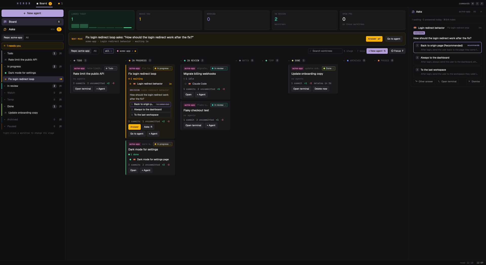

# Board (Herdr)

A Linear-style board of your git worktrees, fed by Herdr itself, git and gh. Every worktree is a card in a stage you
choose (Todo, In progress, In review, Watch, Temp, Done, Archived, Paused); on it, every agent working there and the
sub-agents they started, counted by status, its branch, commits, uncommitted lines and pull request, and the question
an agent is waiting on, with its options to click. A sidebar lists the worktrees by stage, most recently used first,
with a link to each agent. New agent (⌘N) makes a worktree of the shown repo and starts Claude Code or OpenCode in it
on your message plus a Context block (a Linear issue, a PR, a Slack message, any link). Done removes the worktree after
3 days; ⌘W on a worktree's last tab removes it at once. The whole board works from the keyboard.

## What you see

The layout is one column: a 38 px top bar, the body, a 24 px bottom bar. Colors are the graphite theme with the
layout's own `colors` (chrome `#101012`, canvas `#121214`, accent `#b4a0db`, working `#8f7fd1`, blocked `#ffb406`,
done `#53cf91`); text is Geist (UI) and JetBrains Mono (numbers, labels, terminals). The mod's own palette: top
`#101012`, side `#0f0f11`, main `#121214`, card `#1a1a1d`, raised `#242328`, hover `#1f1f23`, lines `#1e1e20` and
`#2a2a30`, text `#e4e4e7` / `#c8c8cc` / `#8a898e` / `#56555b`, accent `#b4a0db` (dim `#625187`), you `#ffb406` (on
`#1f1a10`, card `#1b1912`, question box `#241f12`, border `#4a3a12`), work `#8f7fd1`, land `#53cf91`, red `#e0707f`.

- **Top bar** (`window_drag`): `H E R D R` in 12 px mono bold accent (84 px in from the left on macOS, past the
  traffic lights at [14, 13]); a pinned `▦ Board` tab with a yellow count of agents waiting for you; a divider; the
  shown space's tabs (settled ones hidden unless blocked), each with a yellow dot (blocked) or a spinner (working); the
  shown tab underlined 2 px in accent; at the right `commands ⌘ ⇧ P` as key caps.
- **Sidebar**, 220 px (min 44, max 480), two blocks: the board's `nav` (weight 3) over Herdr's shipped `spaces`
  (weight 1).
  - `+ New agent`, 36 px, filled accent, 14 px semibold.
  - `Board` row (36 px, columns icon, count of worktrees not archived); selected when the board shows with no column
    marked.
  - `Asks` row (34 px, speech-bubble icon, `⌘⇧A` hint, a count pill: yellow when questions wait in scope).
  - The scope switch: two segments, `Repo: <name>` and `All`, 28 px.
  - A needs-you row when an agent waits (yellow on `#1f1a10`, pulsing dot): `2 need you`, plus `N elsewhere` when the
    scope hides some; a click goes to the oldest question.
  - One group per stage: a 3 px bar in the stage's color, a foldable header (`▾ Todo  3`, and a columns button that
    opens the board on that column), then each worktree (30 px: status icon, its name, `2●` waiting, `1◌` working, `+3`
    sub-agents) and, when it has more than one agent, each agent under it (26 px, indented 28 px, its age). Archived
    starts folded. A hint at the bottom: `right-click a worktree to change its stage`.
  - Narrower than 160 px: a 40 px rail of icons and counts, one dot per stage.
- **Main** is a stack: `board` (the board) and `work` (the shown tab's panes as 6 px-radius cards, gap 6, border
  `#1e1e20`, focused `#625187`).
  - **Numbers**, five tiles: `LANDED TODAY` (green, with 7 bars of your merged PRs this week, today's solid),
    `NEEDS YOU`, `WORKING` (with `+ N of M sub-agents`), `IN REVIEW`, `OPEN PRS`.
  - **Next move** banner, when someone waits: `<worktree> asks: "<question>"`, project · agent · `waiting 4m`,
    `Answer ⏎` and `Go to agent`.
  - **Chips row**: the scope switch, `N elsewhere`, a divider, project filter chips (`all 5`, then each project with
    its count and a yellow dot when one of its worktrees waits), `N leftover worktrees · clean up` when there are some,
    then a 170 px search field (`/`), a hint (`S stage · ? keys`), `+ New agent  N` and `◎ Focus  F`.
  - **Columns**, one per stage: header `▾ ● IN PROGRESS 2` (click folds it). A folded column is 140 px, an empty one
    118 px; columns with cards share the rest but never go below 260 px, and below that only the columns row scrolls
    sideways (the numbers and chips keep the view's width). Each column scrolls on its own. The column the sidebar
    marked has a border and a tint in its color.
  - **A card**: a 3 px left bar in the worktree's status color; the project chip (one of 8 colors, from its name), the
    branch, the stage button (`● In progress ▾`, tinted in the stage color); the title (14 px semibold); the agents
    counted (`2 waiting · 1 working`) and, with sub-agents, `· 3 sub-agents` counted too; up to 4 agent lines (status
    icon, program icon, what it says it's doing, a `+2` sub-agent pill, its age) and `+N more`; the question box; the
    facts (`3 commits`, `2 uncommitted`, `+120 −8`, `1 unpushed`, `PR #42`, `✓ checks` / `✗ checks` / `checks running`,
    `conflicts`, `merge blocked`, `behind base`, and in Done `deletes in 2d` or `uncommitted: won't
    auto-delete`); then the actions. A card where someone waits is `#1b1912`; the selected card has an accent border.
  - **The question box** (`#241f12`): with an Asks record, its kind (`APPROVAL` yellow, `DECISION` accent, `QUESTION`
    work, `UNCLEAR` dim), the agent, the question, and up to 6 options as 24 px rows (number, label, `recommended` on
    the agent's pick, `recommended · Y` on the selected card); several questions at once say `3 questions: answer them in
    Asks (R)`; a failed answer shows its error and Retry. Without a record, `ASKS YOU` and the last question line on the
    agent's screen.
  - **Actions**: while someone waits, `Answer` (Focus), `Asks R` (or `Reply R`), `Go to agent`, `+ Agent`; otherwise
    `Merge PR` or `Ship PR` (green), `PR #42 ↗`, a nudge (`→ In review` when a PR is open, `→ Archived` when merged),
    `Open` (or `Open terminal`), `+ Agent`, and in Done `Delete now`. Merge and Ship ask first on the card (`Yes y` /
    `No n`); a running or failed one shows its line on the card.
  - `?` shows a key list in the board's bottom-right corner (350 px, `#18181b`).
- **Asks panel** (hidden; 380 px, min 300, max 720) at the board's right: header with the icon, `Asks`, the scope
  (`workspace` or `All worktrees`), an `All` toggle and ×; a line `1 waiting · 3 answered today · ⌘⇧A hides`; one card
  per waiting question (agent, worktree, age, kind chip, context line, the question, each option with its description
  and `recommends`, a multi-question list that unfolds each question's choices, `Other answer` / `Answer` with a text
  field, `Open terminal`, `Dismiss`); a foldable `Answered N` list.
- **Focus terminal** (hidden; weight 0.5, min 360, max 1000) and **side** (hidden, 640 px): an agent's live terminal
  beside the board.
- **Bottom bar**: right-aligned, the last git or gh problem in red, `read 11:57`, the clock.
- **Dialogs**, all `#18181b`:
  - **New agent** (540×720): `AGENT` (Claude Code and OpenCode as 52 px cards with icon, command and a radio; `not
    installed` dims one); `WHERE` (`New worktree` with `repo · from main · ~/.herdr/worktrees/<repo>/<branch>`, or `In
    this worktree`); for a new worktree `BRANCH` (mono input, `empty: <the branch it will get>`, `on the board: <the
    title it will get>`) and `STAGE` (8 chips); `CONTEXT` (one input; your Linear issues drop down as you type; each
    reference a removable chip colored by kind: Linear `#8b93f8`, PR `#53cf91`, Slack `#e88cc8`, link `#6fb3f2`, note
    `#8a898e`); `FIRST MESSAGE (OPTIONAL)` (or `MESSAGE (OPTIONAL: EMPTY STARTS ON THE ISSUE)`); the error in red; a hint
    (`it starts working; the board stays` or `its terminal opens, to type in`), `Cancel`, `Start ⏎`.
  - **Stage picker** (250 px wide, 44 + 30 per stage + 40 high): `MOVE <title> TO`, one 30 px row per stage (dot, name,
    `✓` on the current one, its number), and for a worktree a red `× Delete worktree…  ⌫`. A popup at the pointer for a
    click, a centered dialog for a key.
  - **Leftover worktrees** (640×480): each worktree under `~/.herdr/worktrees` that no space shows: branch, path, what's
    at risk (`2 uncommitted changes: lost on remove` / `no uncommitted changes` / `folder already gone`, `3 commits on
    no remote (kept on the branch)`), `Open`, `Remove` (`Remove…` then a red `Remove anyway` when it has changes); a footer
    `Remove the N without changes` and `Done`.

## How it behaves

- **Worktrees, not agents.** Each Herdr space is one card. A space's agents come from `agents()`; its sub-agents are
  the live `terminals()` whose chain of `parent`s (up to 8 hops) reaches one of them. Agents sort the most urgent first
  (blocked > done > working > idle), then the one you used last.
- **A worktree's name**: the name you gave the space, else the title New agent gave it (the Linear issue's title, else
  the first sentence of your message, cut at a word under 48 characters), else what its first agent's terminal title
  says it's doing, else the branch.
- **Two statuses kept apart.** An agent's status (working, waiting for you, done, idle) comes from the agent and is
  only shown: a spinner, a pulsing yellow dot, a green dot, a hollow dot. A worktree's stage is yours; the board never
  moves a card, it only suggests (the nudge button). Archived puts the worktree's tabs away (`tab.settle`; they keep
  running and come back when they need you); leaving Archived brings them back.
- **Scope**: the board, the sidebar and Asks show the worktrees of the shown space's repo (its git common dir), or all
  of them. `N elsewhere` counts the agents waiting where you can't see, and a click shows all.
- **Done**: moving a worktree to Done records when; 3 days later, if it is under `~/.herdr/worktrees`, isn't its repo's
  main checkout, and `git status` (checked again just before) is clean, the board closes its space, runs `git worktree
  remove` and toasts `Removed <name>` (the branch and its commits stay). Checked every minute while Herdr runs. Leaving
  Done cancels; coming back restarts the count.
- **Delete a worktree by hand**: `Delete worktree…` in the stage picker (or ⌫ there), ⌫ on the board, `Delete now` on a
  Done card, ⌘W on a worktree's last tab. Each opens Herdr's own Remove worktree dialog, which warns about uncommitted
  changes. ⌘W on any other tab closes it as usual; on the board it does nothing.
- **New agent**, new worktree:
  - The branch is what you typed, else the Linear issue's `branchName`, else `<id>-<title slug>`, else a slug of your
    message (6 words, 40 characters, accents dropped), else `agent-MMDD-HHMM`.
  - The folder is `~/.herdr/worktrees/<repo>/<branch with / as ->`.
  - If git already has a worktree for that branch or folder, it's reused: a space already showing it gets one more tab,
    else a space opens there. Worktrees whose folder is gone are pruned first. A folder that exists but isn't a worktree
    is an error on the dialog.
  - Otherwise it runs `git worktree add --no-track -b <branch> <path> origin/HEAD's branch` (or `add <path> <branch>`
    for an existing branch), then `space.new` in the folder with the agent as its first tab; the space stays unnamed so
    it nests under its repo in Spaces. The stage and title are applied when that space shows up.
  - **In this worktree**: `tab.new` in that space.
  - The first message is your text (or `Start working on the Linear issue X.` when empty with an issue), then
    `Context:` and one line per reference (`- Linear issue: INT-12 — Title (url)`, `- Pull request: owner/repo#4 (url)`,
    `- Slack message: url`, `- Link: url`, `- Note: …`).
  - With a message the board stays; without one the agent's terminal shows. The agent and stage you pick are
    remembered.
- **References**: pasting a `linear.app/…/issue/ABC-12` link or `ABC-12` makes a Linear chip (with its title when it's
  among yours), `github.com/…/pull/N` a PR, `slack.com/archives/` a Slack message, any other `http(s)` a link, anything
  else a note. With `LINEAR_API_KEY` in your shell, your 50 most recently updated open assigned issues drop down as you
  type, and after 3 letters none of them has, Linear's search (400 ms after you stop). Enter on an empty field moves to
  the message.
- **Asks** (from github.com/sachin-philip/herdr-agent-ask 0.3.0):
  - A blocked agent becomes a record within about a second. Claude Code's own report says it: `kind: question` gives a
    DECISION with its options and recommendation, `kind: permission` an APPROVAL whose Yes / Yes, and… / No come from
    the screen.
  - Other agents' numbered options are read off the screen, with `claude -p` (Haiku) as a fallback whose options must
    all appear on screen. Otherwise the record is UNCLEAR.
  - A turn that ends asking in plain text (a `?` in the agent's last message) goes to Haiku once. If it is really
    waiting, it becomes a QUESTION whose answer is sent as a message; several questions in one message become one
    record.
  - Clicking an option (card or panel) or Y presses its number with `hc keys` and Enter if the dialog is still there,
    or `hc send`s the text, then watches for up to 8 s. Delivered means the dialog went away or the turn moved on;
    otherwise the answer is marked failed, with Retry, which never sends twice.
  - Answering in the terminal turns the record into `Resolved in terminal` after 3 s.
  - Each answer is appended to `~/.config/herdr-app/decisions.md`.
- **Keys on the board**:
  - Moving: ↑↓/jk within a column, ←→/hl to the nearest column with cards keeping the row, 1–8 the first card of a stage.
  - Stages: S the stage picker, ⇧←/⇧→ the stage before/after, A archive/unarchive, ⌫ delete the worktree.
  - Agents: ⏎ go to the agent, Space peek (the agent in the focus block, following the selection, the keyboard stays),
    F Focus (only worktrees that wait stay bright, the question's terminal gets the keyboard to type the answer).
  - Answering: Y answer with the recommended option, R the Asks panel.
  - Making and shipping: N/C New agent, ⇧N an agent in this worktree, M merge or ship the PR, O open the PR.
  - Filtering: / search (name, branch, project, agents, question; ↓ or ⏎ back to the cards), V repo/all, P next project.
  - ? key list. Esc backs out one step: the key list, the search, the peek, Focus, the marked column, the selection.
- **Keys anywhere in the layout** (keys.json): ⌘E board ↔ the agent you were on (also out of Focus); ⌘N New agent;
  ⌘W close the tab, or remove the worktree on its last tab; ⌘⇧A the Asks panel; ⌘⇧B the board. From any other layout,
  ⌘⇧B switches to this one.
- Clicking a space in the sidebar's Spaces shows its terminal (in All scope); a click on an agent or worktree row goes
  to its agent (agent.focus, pane.focus, the `work` child). The sidebar's agent order is what ⌘] / ⌘[ follow.
  Right-click any worktree or agent row: the stage picker at the pointer.
- The board reads git in each space's folder every 10 s and whenever an agent's status or a space's folder changes; gh
  for each branch's PR every 60 s; your merged PRs of the week every 5 min; the screen question of blocked agents every
  5 s.

## Built from

- `layouts/board-herdr.json`: root `column`, `titlebar: none`, `traffic_lights: [14, 13]`, `theme: graphite` plus the
  `colors` above, `font: JetBrains Mono`, `ui_font: Geist`, `preview: mods/board-herdr/preview.png`. Children:
  - `top`: block, 38 px, `window_drag`, `{mod: board-herdr, props: {part: top}}`.
  - `body`: row, divider 1 `#1e1e20`. Its children:
    - `sidebar`: column, 220 px, min 44, max 480, background `chrome`, with `nav` (weight 3, part `nav`) over `spaces`
      (weight 1, the shipped `spaces` mod).
    - `main`: stack, active `board`, with `board` (part `board`) and `work` (`{tab: active}` with the pane frame above).
    - `asks`: hidden, 380 px, min 300, max 720, part `asks`.
    - `focus-term`: hidden, weight 0.5, min 360, max 1000, `{agent: focused}`.
    - `side`: hidden, 640 px, `{tab: active}`.
  - `bottom`: block, 24 px, part `bottom`.
- `mods/board-herdr/` (`mod.json`: `{place: none}`):
  - `main.js` draws every part from `props().part`: `top`, `nav`, `board`, `bottom`, `asks`, and the overlays `new`,
    `stage` and `cleanup`, which it opens itself with `openOverlay({mod: "board-herdr", props: {part, …}})`.
  - `asks.js`: `Answerer` delivers an answer (used by the board's cards); `AsksPanel` is the `asks` part.
  - `asks-engine.js`: the Asks detection; `asks-state.js`: the record and `asks.json`.
  - Art: `columns.svg`, `spinner.svg`, `asks.svg`, `ask-check|x|send|terminal.svg`; it also uses the shipped
    `mods/workspace-chrome/spinner.svg` and `chevron-*.svg`.
- Copies: the `board` copy owns the keyboard (`cx.focus_handle()`, `on_key_down`), git, gh, Done and the cards; the
  `nav` copy runs the Asks engine and takes `board-herdr.*` key commands (`open-board`, `open-<stage>`, `new-agent`,
  `close`, `toggle`, `go-<address>`, `asks`, `asks-open`, `asks-recheck`); the board copy takes `focus`, `unfocus`,
  `toggle`, `next/prev/left/right`, `peek`, `go`, `archive`, `delete`, `stage`, `add-agent`, `scope`, `stage-next`,
  `stage-prev`, `merge`, `yes`, `no`; the `asks` copy takes `asks-accept`.
- Shared state (`shared`/`setShared`):
  - Views: `boardh.view`, `boardh.left`, `boardh.focus`, `boardh.peek`, `boardh.col`, `boardh.refocus`, `boardh.stay`.
  - What the bars show: `boardh.counts`, `boardh.repos`, `boardh.scope`, `boardh.fold`, `boardh.used`.
  - New agent: `boardh.agent`, `boardh.newStage`, `boardh.pending`.
  - Worktrees: `boardh.spaceStages`, `boardh.stageAt`, `boardh.spaceTitles`.
  - Asks: `asks.state`.
- `herdr` functions:
  - Data: `spaces`, `agents`, `terminals`, `panes`, `focused`, `layout`, `shared`/`setShared`, `props`, `window`,
    `home`, `knownAgents`.
  - Acting: `run`, `exec`, `hc`, `notify`, `openOverlay`/`closeOverlay`, `nextCommand`, `setAgentOrder`.
- Commands it runs:
  - Layout: `layout.select {stack: main, child}`, `layout.show/hide {id: focus-term | asks}`.
  - Moving to agents: `agent.focus`, `pane.focus {terminal}`, `space.select`.
  - Making: `space.new {folder, tab, argv, task, machine}`, `tab.new {space, argv, task, name}`.
  - Closing: `tab.close`, `tab.settle`/`tab.unsettle`, `space.close {confirmed: true}`.
- Programs:
  - git: `rev-parse`, `branch`, `status --porcelain`, `merge-base`, `rev-list`, `diff --shortstat`,
    `worktree list --porcelain|add|remove|prune`, `show-ref`.
  - gh: `pr view --json number,url,state,isDraft,mergeStateStatus,statusCheckRollup`, `pr merge --squash|--merge|--rebase`
    (whichever the repo allows), `pr create --fill` after `git push -u origin HEAD`, `search prs --author=@me --merged-at`.
  - hc: `read`, `get`, `keys`, `send`.
  - `claude -p --model haiku --output-format json --json-schema …` (Asks).
  - `sh -c` to read `LINEAR_API_KEY` from your login shell, and `fetch` to `api.linear.app/graphql`.
- Shipped mods it opens: `worktree` (`{space, action: "remove"}`, 440×260) for every delete.
- `keys.json`: `"layout:board-herdr": {"cmd-e": "board-herdr.toggle", "cmd-n": "board-herdr.new-agent", "cmd-w":
  "board-herdr.close", "cmd-shift-a": "board-herdr.asks", "cmd-shift-b": "board-herdr.open-board"}` and under `global`
  `"cmd-shift-b": "layout.switch:board-herdr"`.
- `~/.config/herdr-app/asks.json` is optional (Asks' settings: `label`, `log`, `classify`, `model`, `trailing_questions`,
  `toast`, `debug`); the board's default `log` is `~/.config/herdr-app/decisions.md`.

## Watch out

- **Focus can't move while drawing, nor from `cx.spawn`.** `FocusHandle.focus()` during render throws; from a task it
  does nothing. The board takes the keyboard with `cx.timer.after(30, () => this.h.focus())`.
- **Overlays don't give the keyboard back.** Herdr only does that for focusable mods. The overlays' `async close()`
  sets `boardh.refocus`, and the board grabs focus when it changes, except in Focus. Without this, arrows die after S
  then Esc.
- **`min_w` inside a scroll container is ignored.** Columns get explicit widths computed from the columns row's
  `on_size_change`. Only that row scrolls sideways; putting the numbers and chips inside it makes them scroll too. Use a
  plain `div().flex().flex_row()` for the row: `h_flex` centers its children and shrinks each column to its header.
- **Herdr's `task` is appended as the last argument.** Claude Code takes that; OpenCode reads its first positional as
  a project folder, so it gets `--prompt <task>` instead.
- **`process.env` doesn't exist.** Read `LINEAR_API_KEY` with `sh -c 'printf %s "$LINEAR_API_KEY"'`, then through the
  login shell (`exec "${SHELL:-/bin/zsh}" -lic …`). Keep only the `lin_api_…` match from the output: rc files print
  things.
- **`space.new` doesn't say which space it made.** `boardh.pending` holds the stage and title with the folder; the
  `nav` copy gives them to the space that shows up there, within 2 minutes.
- **`git worktree add` fails on a folder a closed space left.** Reuse the branch's or folder's worktree, `prune` the
  ones whose folder is gone, and only then add.
- **Only remove under `~/.herdr/worktrees`, and never the repo's main checkout.** Compare `--show-toplevel` with the
  common dir's parent.
- **Asks' own default log is `docs/decisions.md` in the agent's repo.** That untracked file makes every worktree dirty,
  so Done never removes it and the cleanup won't either; the board's default is outside the repo, keep it there.
- Asks calls `claude -p` on every finished turn with a `?`, sending that message to Anthropic through your Claude Code
  login. `"trailing_questions": false` or `"classify": "off"` in `asks.json` stops it.
- `<mod>.<command>` reaches only shown copies, and every shown copy of the mod gets it. Give each command to exactly
  one part (the nav for New agent, the board for moves), or New agent opens twice. A hidden stack child takes no
  commands, which is why the engine and the layout-wide commands live in the nav.
- Every `setShared` redraws every mod: write shared state only when it changed (compare the JSON).
- gpui-kit style setters want a value: use `.when(cond, el => el.bg(x))`, not `.bg(cond ? x : undefined)`.
- Editing `keys.json` makes the whole file yours: Herdr stops updating its default keys.
- The layout remembers a shown `focus-term` across reloads; the board hides it on start and clears `boardh.focus` and
  `boardh.peek`.
- Stages used to be a `herdr.stage` label on each agent's terminal; a space with no stage of its own reads its first
  agent's old label once.
- `herdr-app shot` returns the last frame drawn; while Herdr is in the background it may be stale.
- Limits: 4 agents listed per card, 6 options on a card, 60 Asks records kept 24 h, 6 Linear suggestions.
- Assumes git; gh for PRs (without it the PR facts and the week's bars are empty); Claude Code and/or OpenCode for New
  agent; `hc` and `claude` for Asks.

## Done when

- `herdr-app check mods/board-herdr` passes and `herdr-app status` shows `"layout": "board-herdr"` with no errors.
- The board shows one column per stage, the cards of the shown repo's worktrees, and `V` (or the switch) shows every
  repo's.
- `↓ ↑ ← →`, `1–8`, `S` (the picker) then `Esc`, then `↓` again moves the selection: the keyboard came back.
- `⇧→` on a card moves it to the next stage; the sidebar group and the stage button follow; after a reload it stays.
- Opening the agent beside the board (Space) narrows the board: the columns scroll sideways, the numbers and chips
  don't.
- New agent with a message on a repo space creates `~/.herdr/worktrees/<repo>/<branch>` on a new branch, a space there
  with the agent working on that message, in the chosen stage, titled from the message; running it again for the same
  branch reuses the worktree instead of failing.
- With a Linear issue and an empty message, the agent's first message is `Start working on the Linear issue X.` plus a
  Context block, and the branch is the issue's `branchName`.
- ⌘W on a worktree's last tab opens Remove worktree; after it, `git worktree list` no longer has it and the branch
  remains.
- A clean worktree in Done with its time 3 days back is removed within a minute (space closed, branch kept, a toast); one
  with an uncommitted file stays and its card says it won't delete itself.
- `hc send <t> "Use the AskUserQuestion tool to ask which colour I prefer: Red, Green, Blue; recommend Green"` gives the
  card a DECISION box with `Green` marked recommended and the sidebar's Asks count 1; Y (or a click) answers, the agent's
  screen says `→ Green`, and `decisions.md` gains the line.
- An agent asked to ask in plain text whether to use tabs or spaces gets a QUESTION within about 10 s; answering sends
  the option as a message and the agent replies.
- ⌘⇧B from another layout opens this one on the board; ⌘E goes from the board to the agent you were on and back.
